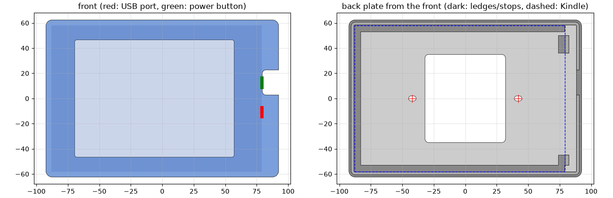

# Wall case

> **⚠️ Use at your own risk.** This case mounts onto a wall-plate bracket that is normally wired to mains-adjacent control electronics. See the [top-level README](../../README.md#safety) for the full disclaimer.

A two-part PLA case for mounting the Paperwhite 4 on an Australian wall-plate bracket, in landscape with the USB port on the right.



## Parts

| STL | Print orientation | Size |
|---|---|---|
| `stl/back_plate.stl` | wall side down, as exported | 185 × 125 × 17.6 mm |
| `stl/front_plate.stl` | face down, as exported | 185 × 125 × 12.4 mm |
| `stl/test_back_end.stl`, `stl/test_front_end.stl` | as above | the right-hand 45 mm of each |

**Print the test pieces first.** They are the right-hand end of each plate. Use them to check:
- the Kindle's height fit;
- the plug pocket and the power-button notch;
- how one pair of snap tabs feels.

**Print settings.** Everything prints without supports on the Mk4: PLA, 0.2 mm layers, 3 perimeters. All overhangs are 45° or less.

## How it fits together


- **Back plate.** It is held on by the two bracket screws (84 mm centres). The screw holes are slotted ±1 mm sideways for slack.
  - **Wall opening.** A 64 × 70 mm opening between the screws leads to the hole in the wall.
  - **Cable space.** The Kindle sits on 5 mm ledges, 6 mm off the back panel, which leaves room behind it for the cable and the screw heads.
  - **Clearance.** There's 0.4 mm all round the Kindle.
- **Plug pocket.** A 9 mm pocket runs down the right-hand end, beyond the Kindle's edge.
  - **Locating stops.** Two stops keep the Kindle in place sideways: one 8–22 mm from the top, and one 5–13 mm from the bottom.
  - **Cable route.** The cable dives from the pocket into the space behind the Kindle, between the stops, and then runs to the wall opening.
- **Front plate.** It covers the bezel, and its skirt wraps over the back plate's walls down to a seam 7 mm off the wall.
  - **Snap tabs.** There are three tabs on the top edge and three on the bottom. Each has a 45° bump that clicks into a groove in the back plate.
  - **Removing it.** Hook a finger into the scoop under the bottom edge and pull it forwards.
- **Screen opening.** The opening is 0.75 mm larger than the active area on every side, and its edge is chamfered so it doesn't shade the edges of the screen.
- **Power button.** A 20 mm notch, open at the front and the side, exposes the power button.

## The USB cable

The case is sized for a flat micro-USB cable whose plug sticks out 7.5 mm from the Kindle's edge, leaving about 1.5 mm spare in the 9 mm pocket. The cable should head **down**, towards the bottom of the case, because the power button is above the port. That leaves about 30 mm between the port (65–72 mm from the top) and the bottom stop for the cable to bend into the space behind the Kindle.

A full-size plug won't fit. To use a longer plug, increase `POCKET`.

## Changing it

The STLs are generated by `case.py` from the parameters at the top of the file:

```bash
pip install manifold3d numpy trimesh
```

```bash
python case.py
```

The parameters you're most likely to need:

| Parameter | What it sets |
|---|---|
| `USB_FROM_TOP`, `POWER_FROM_TOP` | where the port and button are, in mm from the Kindle's top edge (measured) |
| `TOP_STOP`, `BOTTOM_STOP` | where the stops that locate the Kindle sideways are |
| `SCREEN_*` | bezel widths |
| `CLR` | fit of the Kindle |
| `BUMP`, `GROOVE` | how firmly the front clips on |
| `POCKET` | room for the plug |
