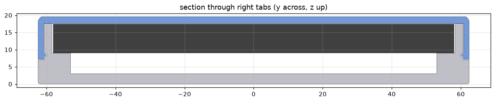
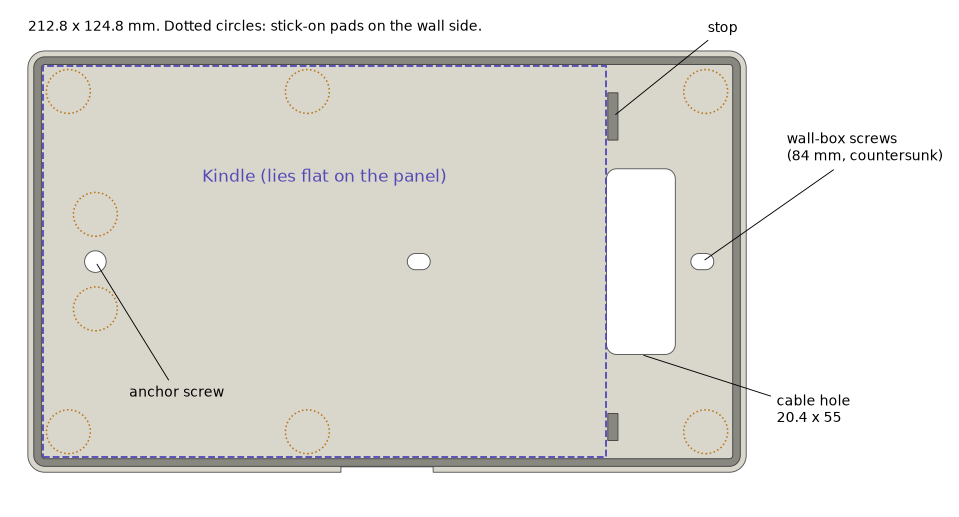
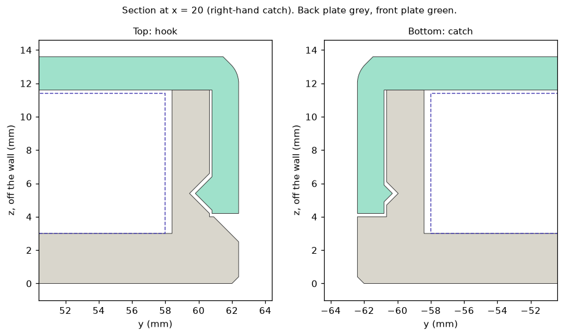

# Wall case

> **⚠️ Use at your own risk.** This case mounts onto a wall-plate bracket that is normally wired to mains-adjacent control electronics. See the [top-level README](../../README.md#safety) for the full disclaimer.

A two-part PLA case for mounting the Paperwhite 4 on an Australian wall-plate bracket, in landscape with the USB port on the right.


## Parts

| STL | Print orientation | Size |
|---|---|---|
| `stl/back_plate.stl` | wall side down, as exported | 193 × 125 × 17.6 mm |
| `stl/front_plate.stl` | face down, as exported | 193 × 125 × 12.4 mm |
| `stl/test_back_end.stl`, `stl/test_front_end.stl` | as above | the right-hand 45 mm of each |

**Print the test pieces first.** They are the right-hand end of each plate. Use them to check:
- the Kindle's height fit;
- the plug pocket and the stops that locate the Kindle sideways;
- how one pair of snap tabs feels.

**Print settings.** Everything prints without supports on the Mk4: PLA, 0.2 mm layers, 3 perimeters. All overhangs are 45° or less.

## How it fits together



- **Back plate.** It is held on by the two bracket screws (84 mm centres). The screw holes are slotted ±1 mm sideways for slack.
  - **Wall opening.** A 64 × 70 mm opening between the screws leads to the hole in the wall.
  - **Cable space.** The Kindle sits on 5 mm ledges, 6 mm off the back panel, which leaves room behind it for the cable and the screw heads.
  - **Clearance.** There's 0.4 mm all round the Kindle.
- **Plug pocket.** A 17 mm pocket runs down the right-hand end, beyond the Kindle's edge.
  - **Locating stops.** Two stops keep the Kindle in place sideways: one 8–22 mm from the top, and one 5–13 mm from the bottom.
  - **Cable route.** The cable dives from the pocket into the space behind the Kindle, between the stops, and then runs to the wall opening.
- **Front plate.** It covers the bezel, and its skirt wraps over the back plate's walls down to a seam 7 mm off the wall.
  - **Snap tabs.** There are three tabs on the top edge and three on the bottom. Each has a 45° bump that clicks into a groove in the back plate.
  - **Removing it.** Hook a finger into the scoop under the bottom edge and pull it forwards.
- **Screen opening.** The opening is 0.75 mm larger than the active area on every side, and its edge is chamfered so it doesn't shade the edges of the screen.
- **Power button.** It's covered: the front plate closes over the whole right-hand end.

## The USB cable

The case is sized for a micro-USB cable whose plug sticks out 15.5 mm from the Kindle's edge, leaving about 1.5 mm spare in the 17 mm pocket. The cable can head either way along the pocket before it bends into the space behind the Kindle:
- **Down:** there's about 30 mm between the port (65–72 mm from the top) and the bottom stop.
- **Up:** there's about 43 mm between the port and the top stop.

A full-size plug won't fit. To use a longer plug, increase `POCKET`. The case is centred on the screws, so a wider pocket moves the Kindle left relative to them.

## Changing it

The STLs are generated by `case.py` from the parameters at the top of the file:

```bash
pip install manifold3d numpy trimesh
```

```bash
python case.py
```

The parameters you're most likely to need:

| Parameter | What it sets |
|---|---|
| `USB_FROM_TOP` | where the port is, in mm from the Kindle's top edge (measured) |
| `TOP_STOP`, `BOTTOM_STOP` | where the stops that locate the Kindle sideways are |
| `SCREEN_*` | bezel widths |
| `CLR` | fit of the Kindle |
| `BUMP`, `GROOVE` | how firmly the front clips on |
| `POCKET` | room for the plug |

## Flat-mount variant

`case_flat.py` builds a second design, which writes `stl/flat_*.stl`. In this design the Kindle lies directly on the back panel, with nothing behind it. The case sits off-centre on the wall box, so the cable can drop from the plug pocket straight into the box.



| STL | Print orientation | Size |
|---|---|---|
| `stl/flat_back_plate.stl` | wall side down, as exported | 213 × 125 × 11.6 mm |
| `stl/flat_front_plate.stl` | face down, as exported | 213 × 125 × 9.4 mm |
| `stl/flat_test_back_end.stl`, `stl/flat_test_front_end.stl` | as above | the right-hand 55 mm of each |

The test pieces include the pocket, the cable hole, the right-hand screw, part of the top hook and one bottom catch.

**Narrow version.** `python case_flat.py narrow` writes `stl/flat_narrow_*.stl`: the same design, 10.4 mm narrower (202.4 mm).
- **Pocket.** It's 26.6 mm, which still leaves about 11 mm past the 15.5 mm plug for the cable to loop.
- **Kindle and hole.** The right-hand screw is still 13 mm from the edge. The Kindle sits 10.4 mm further right, so the cable hole is 10 mm wide.
- **Front plate.** It has its own front plate, `flat_narrow_front_plate.stl`.

- **Screws.** The right-hand screw is 13 mm from the case's right edge.
  - **Wall-box screws.** Both are countersunk flush on the Kindle side, because the left one sits under the Kindle. Use flat countersunk M3.5 × 0.6 screws; a raised head would touch the Kindle. Tighten them just snug, because the bracket lugs sit back inside the cutout.
  - **Anchor screw.** A third countersunk hole, 20 mm from the left edge, takes a 4 mm (#8) countersunk screw into a plasterboard anchor. To place the anchor, fit the plate on the box screws and mark through the hole.
- **Cable hole.** It's 20.4 × 55 mm. It runs from the Kindle's right edge to 8 mm short of the right-hand screw, and is centred on the screws to match the 55 mm wall-box opening. The 37 mm pocket leaves room to loop the cable from the 90° plug (up or down) before it drops into the hole.
- **Back panel.** It's 3 mm thick.
  - **Pads.** The wall side has eight 0.4 mm-deep recesses for 12.7 mm stick-on bumper pads, about 1 mm thick, so the plate bridges small bumps in the wall. They're stick-on rather than printed: printed pads would leave the rest of the panel's underside hanging in the air.
- **Front plate.** It hooks over the top and clips at the bottom.
  - **Hook.** A rib along the inside of the top skirt engages a groove along the back plate's top wall.
  - **Catches.** Two catches on the bottom skirt click into grooves.
  - **Fitting it.** Hold the front plate tilted, bottom edge out, and about 1.5 mm higher than its final position. Rest it on the top wall and slide it down so the hook drops into its groove. Then swing the bottom in until the catches click. The tilt that works is about 4–10°; a chamfer along the top ledge makes room for it.
  - **Removing it.** Pull the bottom out using the finger scoop, then lift the plate off the hook.



```bash
python case_flat.py
```
