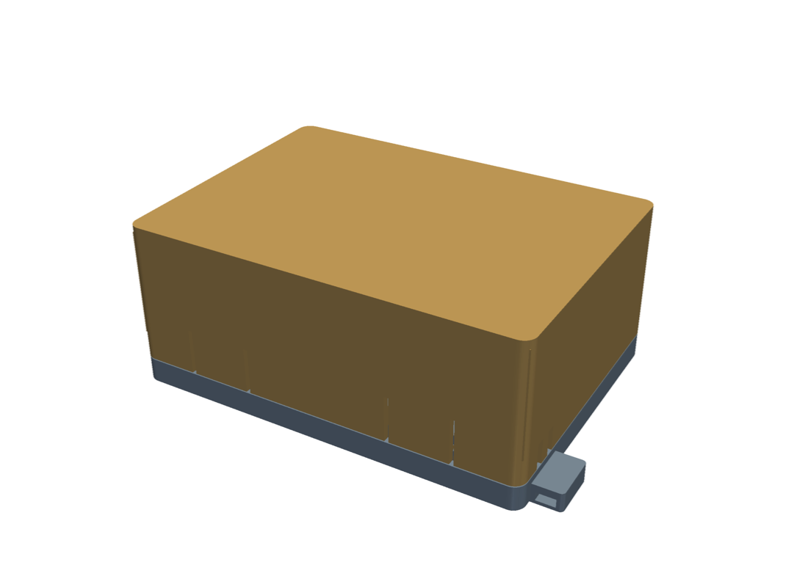
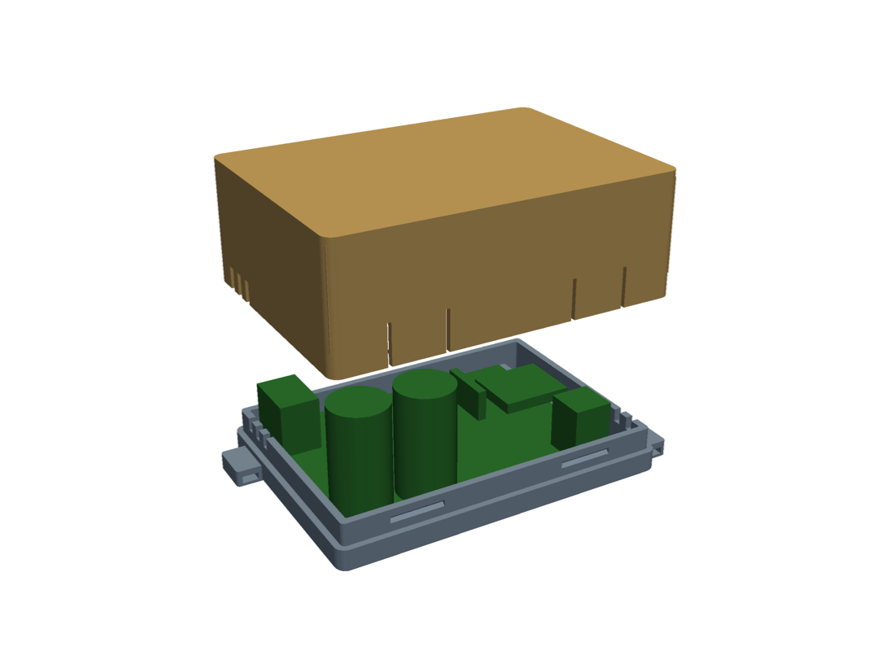
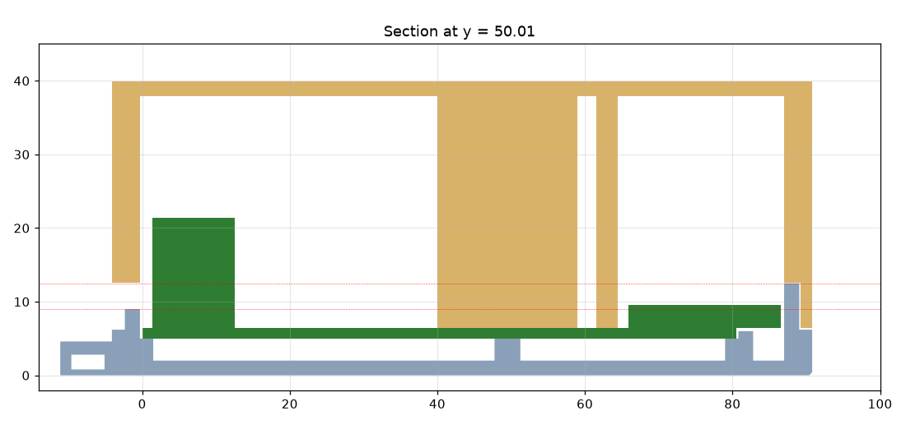
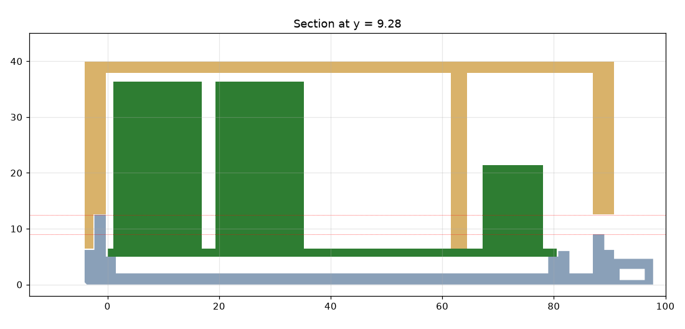
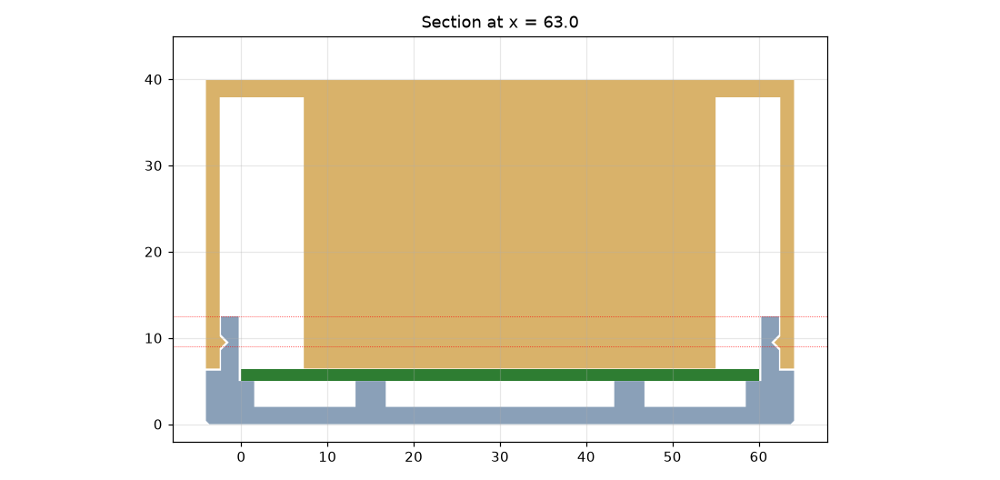

# ESP32 board case

> **⚠️ Use at your own risk.** This board connects to the air-con's relay module. See the [top-level README](../../README.md#safety) for the full disclaimer.

A two-part case for the ESP32 board: a tray the board drops into, and a snap-on lid. The lid is flat on top, tall enough to clear C2/C3, the two 30 mm capacitors. The case is meant to sit loose, or on double-sided tape, in the air-con's cupboard (below 60 °C).





## Parts

| STL | Print orientation | Size |
|---|---|---|
| `stl/tray.stl` | floor down, as exported | 109 × 68 × 12.5 mm (95 mm long without the cable-tie lugs) |
| `stl/lid.stl` | flat top down, as exported | 95 × 68 × 33.4 mm |
| `stl/test_tray_end.stl`, `stl/test_lid_end.stl` | as above | the right-hand 34–41 mm of each |

**Print the test pieces first.** They are the right-hand end of each part. Use them to check:
- the J2 comb and the wire size;
- the antenna clearance;
- how one pair of snap tabs feels.

**Print settings.** Both parts print without supports on the Mk4: PLA or PETG, 0.2 mm layers, 3 perimeters.
- **Lid orientation.** The lid prints upside down, on its flat top. Its walls and the strips that press on the board all grow straight up from the top, so there are no bridges. The only overhangs are the 45° faces of the tab bumps.

## How it fits together



- **Board.** The board sits on a 1.5 mm ledge round its edge, 3 mm off the floor, which clears the 2.5 mm of through-hole solder.
  - **Locating.** The walls locate it with 0.3 mm clearance on three sides. A low stop locates the right-hand edge. It's below the board's top face, so the antenna passes over it.
  - **Antenna.** The tray is 6.5 mm longer than the board on the right-hand end, for the antenna. That's its 6 mm overhang plus 0.5 mm.
- **Holding the board down.** The lid holds the board down, because the board has no mounting holes.
  - **Strips.** Four 3 mm-wide strips hang from the lid's roof and press on bare board. They're 19–48 mm long, and each runs at least 0.6 mm clear of every part's courtyard.
  - **Posts.** Square posts in the tray sit under the strips, so the board can't bow.
- **Wire combs.** Each wire has its own 2.2 mm notch in the end walls.
  - **Height.** The notch runs from 2.6 mm to 6.1 mm above the board's top face.
  - **Fitting the lid.** The lid's skirt has a slot in front of each notch that's open at the bottom, so the lid drops on over the wires. The lid's end walls then close the top of each notch.
  - Change `NOTCH_W` once you've measured the wire.
- **Snap tabs.** There are two tabs on each long side. Each has a 45° bump that clicks into a groove in the tray.
  - **Removing it.** Use the finger scoop in the middle of the top long side.




## Cable-tie anchors

There's a lug at floor level outside each comb, with a tunnel through it for a cable tie up to 4 mm wide.

**Fitting the cable:**
1. Put the board in the tray.
2. Strip the sheath back so the wires are long enough to reach the terminals, with the sheath ending just past the lug.
3. Screw each wire into its terminal and lay it in its notch.
4. Lay the sheathed part of the cable on top of the lug.
5. Thread a cable tie through the tunnel, bring it up round the cable, and pull it tight. Snip off the tail.
6. Snap the lid on.

Leave a little slack in the wires between the tie and the comb, so that the tie takes any pull, not the wires.

**Why bother:**
- **Strain relief.** A pull on the cable then goes into the case, not into the J1/J2 screw terminals.
- **When it matters.** It matters most because the case sits loose: without the tie, anything that drags the cable drags the case by its wires.

**Turning them off.** Set `ZIP = False` if the cables are fixed down some other way. That makes the tray 14 mm shorter.

## Changing it

Everything is set by the constants at the top of `case.py`:
- **The board.** Its dimensions and part heights, the J1/J2 pin positions, and the C2/C3 centres. These are taken from `aircon-esp32-board.kicad_pcb`.
- **The fit.** Clearances, `NOTCH_W`, the strips in `PRESS`, and the posts under them in `POSTS`.

Each strip must land on bare board, and each post must clear the through-hole solder underneath. If the board layout changes, check them again.

```
pip install manifold3d numpy trimesh
python case.py
```
